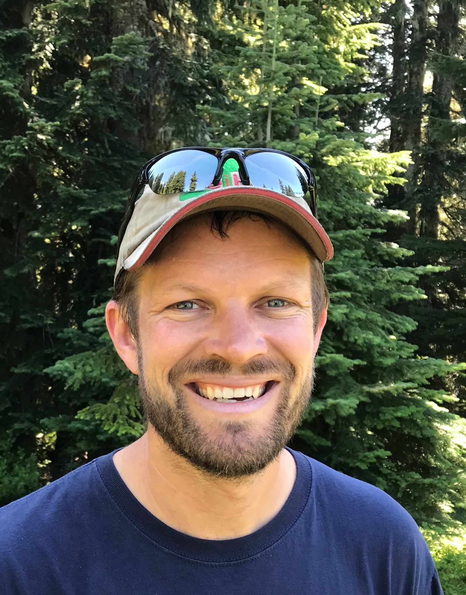
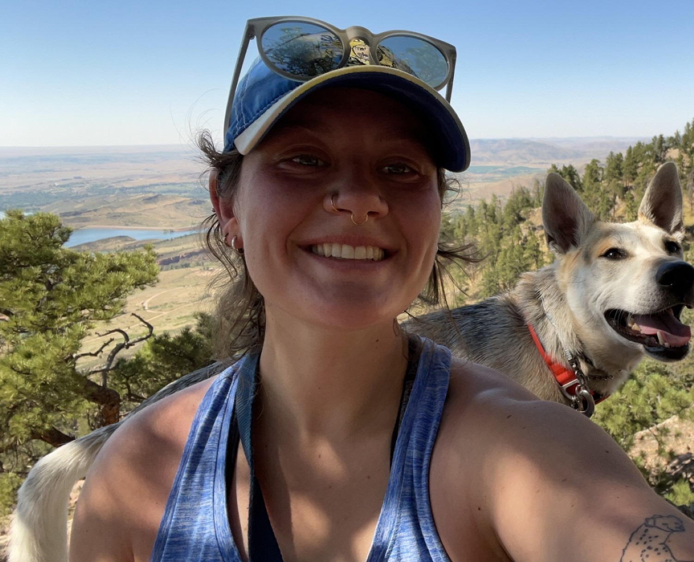

## Principal Investigator

::::: {.grid .person}
::: {.g-col-12 .g-col-md-3}
{.img-fluid style="border-radius: 8px;"}
:::

::: {.g-col-12 .g-col-md-9}
### Zack Steel

**Principal Investigator**

Zack is a Research Ecologist with the Forest Service, Rocky Mountain Research Station in Fort Collins, CO and an Affiliate Faculty at Colorado State University. He is interested all things forest disturbance, and wildlife, especially western forests, birds, and bats.

Email: zachary.steel\[at\]usda.gov  ·  <!-- [Email](mailto:you@university.edu) &nbsp;·&nbsp; --> [Google Scholar](https://scholar.google.com/citations?user=HQaJ7J0AAAAJ&hl=en&oi=sra)  ·  [Forest Service Profile](https://research.fs.usda.gov/about/people/zachary.steel)  ·  [CV](cv/Steel-CV.pdf) 
:::
:::::

## Current Researchers

::::: {.grid .person}
::: {.g-col-12 .g-col-md-3}
{.img-fluid style="border-radius: 8px;"}
:::

::: {.g-col-12 .g-col-md-9}
### Leah McTigue

**Research Associate**

Leah is an Ecological Research Associate with Colorado State University Warner College of Natural Resources, Forest and Rangeland Stewardship and the U.S Forest Service Rocky Mountain Research Station in Fort Collins. She received her master’s degree from the University of Arkansas in 2023 on wildlife response to urbanization in Northwest Arkansas. In her current role, she is assessing the impact of the 2020 wildfire season on wildlife in the Southern Rocky Mountains, specifically looking at the Cameron Peak fire, Mullen fire, and East Troublesome fire.

Email: leah.mctigue\[at\]colostate.edu  ·  [Google Scholar](https://scholar.google.com/citations?user=O1BZJu4AAAAJ&hl=ena)  ·   ·  [CV](cv/McTigue CV.pdf) 
:::
:::::

::::: {.grid .person}
::: {.g-col-12 .g-col-md-3}
{.img-fluid style="border-radius: 8px;"}
:::

::: {.g-col-12 .g-col-md-9}
### Hailey Boone

**Postdoctoral Researcher**

\[A few sentences on their project or research interests.\]
:::
:::::

::::: {.grid .person}
::: {.g-col-12 .g-col-md-3}
{.img-fluid style="border-radius: 8px;"}
:::

::: {.g-col-12 .g-col-md-9}
### Ellie Bolas

**Postdoctoral Researcher**

\[A few sentences on their project or research interests.\]
:::
:::::

```{=html}
<!-- TEMPLATE: copy this whole block for each additional student, postdoc, or
     staff member. Keep the four ::: fences balanced — every ::: that opens a
     div needs its own closing :::, and the blank line before each closing
     ::: matters.

     Image paths are case-sensitive on the live site: images/Jane.JPG and
     images/Jane.jpg are different files there, even though they look the same
     on a Mac. Type the filename exactly as it appears in the images/ folder.

     The links line is optional. To link a CV, put the PDF in the cv/ folder
     (lowercase name, e.g. cv/jane-doe.pdf) and add [CV](cv/jane-doe.pdf).

::: {.grid .person}

::: {.g-col-12 .g-col-md-3}
{.img-fluid style="border-radius: 8px;"}
:::

::: {.g-col-12 .g-col-md-9}
### Full Name
**Position** (started YEAR)

[A few sentences on their project or research interests.]

Email: jane.doe\[at\]university.edu &nbsp;·&nbsp; [Google Scholar](https://scholar.google.com/) &nbsp;·&nbsp; [CV](cv/jane-doe.pdf)
:::

:::

-->
```

## Lab Alumni

::::: {.grid .person}
::: {.g-col-12 .g-col-md-3}
{.img-fluid style="border-radius: 8px;"}
:::

::: {.g-col-12 .g-col-md-9}
### Merijn van den Bosch

**Postdoctoral Researcher** - now \[current position\]
:::
:::::
