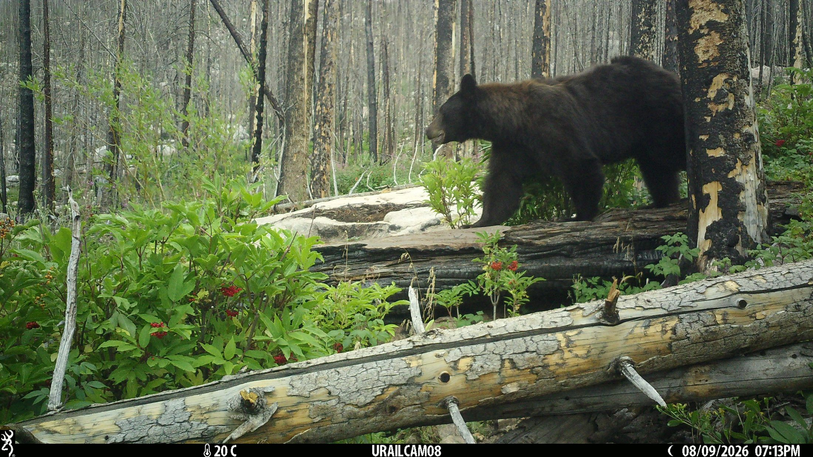
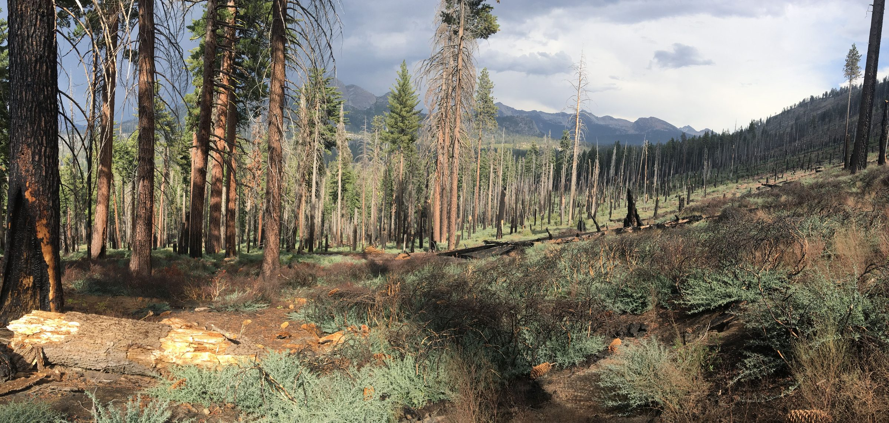
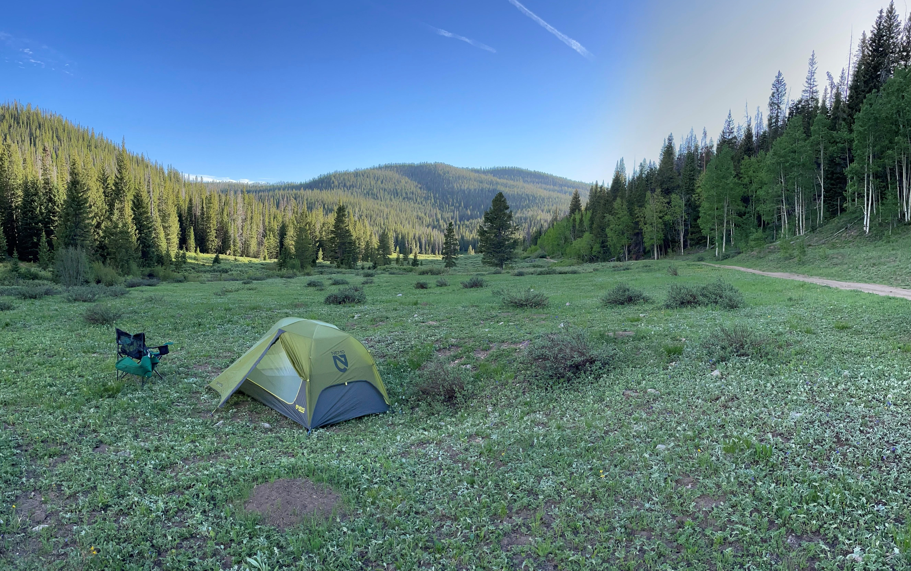
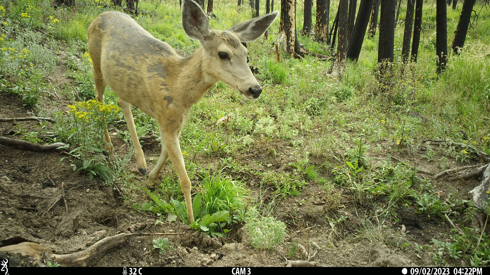
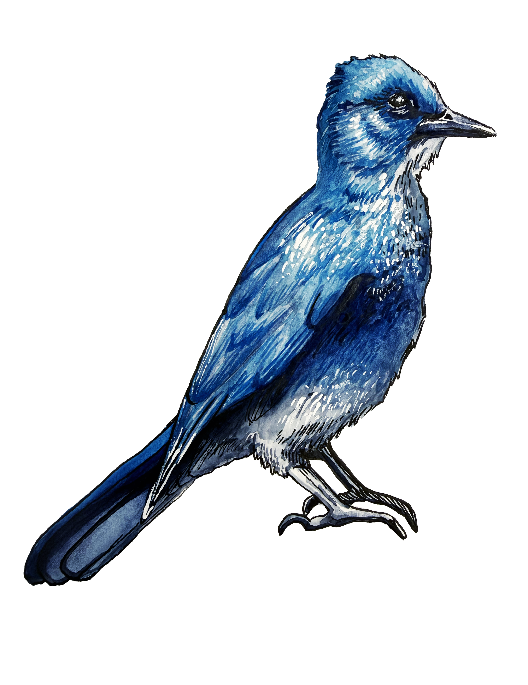

## Overview

Our research focuses on understanding how biodiversity and ecosystem function respond to natural and anthropogenic disturbances, including fire, drought, and land use change. We use a combination of field studies, spatial analyses, and modeling approaches to address questions related to wildlife response to change, forest resilience, and biodiversity conservation in the face of global change. Our work is motivated by the need to inform management and policy decisions that promote sustainable ecosystems and biodiversity conservation.

## Projects

<!-- ===================================================================
     Each project below becomes a clickable tile. Clicking a tile, or the
     Previous / Next buttons under a project, swaps which project is shown,
     so visitors never have to scroll past one project to reach the next.
     Tiles appear in the same order as the projects below.

     To add a project, copy one block: a ### heading, one image, and a
     paragraph. Put the image first; a caption in the [brackets] shows
     under it. Optional extras in the {braces} after the heading:

       #some-id     link straight to the project: research.html#some-id
       short="..."  a shorter title for the tile (default: the heading)
       thumb="..."  a different picture or icon for the tile
                    (default: the project's own image)

     Project-specific photos can go in images/research/.
     =================================================================== -->

::: {#research-projects}

### Colorado Fires and Wildlife {#wildlife-COFires short="Colorado Fires & Wildlife"}

The 2020 wildfire season was record breaking across the world, with over 50,000 wildfires reported in the US alone. These fires are emblematic of changing fire regimes, with large severe fires becoming more frequent. Wildlife response to fire is often variable, highlighting the need to understand species response to changing fire regimes. We deploy Automated Acoustic Recording Units (ARUs) and camera traps to survey wildlife communities across three historic fires that burned in the Southern Rocky Mountains: the Cameron Peak, Mullen, and East Troublesome fires. Our work using camera traps to assess terrestrial mammal use of these burned areas is currently in review. Analyses using acoustic data to assess bird and bat responses are ongoing - stay tuned. 

### Fire Ecology and Forest Resilience {#fire-ecology short="Fire & Forests"}

[Zack will complete this one]

### Global change and biodiversity trends {#biodiversity-trends short="Biodiversity trends"}

[Zack will fill in this one w/ text from Hailey about IUCN]

### Drought and wildlife {#Drought-wildlife short="Drought and wildlife"}

[We can all help on this one. Does someone want take a first crack at it?]

### Forest management & western birds {#Management-birds short="Forest management & western birds"}

Active forest management is practiced across US forests to achieve many objectives including reducing wildfire hazard, timber production, and wildlife habitat management. Understanding how these actions influence animal communities is important for successful multi-use management of public lands and wildlife conservation. To this end, we are conducting multiple projects investigating biodiversity response to forest treatments.

*Adaptive Silviculture for Climate Change (ASCC)*  
As part of a long-term manipulative experiment we are testing how wildlife respond to three forest management strategies (i.e., resistance, resilience, and transition) across three distinct forest types in Colorado. We use acoustic recording units (ARUs) and remote cameras survey birds, bats, and terrestrial mammals within experimental units. To date, we have completed pre-treatment surveys and are beginning to test the immediate effects of different levels of tree removal. In the years to come we will examine long-term wildlife responses to changes in forest structure, composition, and succession. 

*Western birds’ response to forest treatments*  
In collaboration with researchers at the Cornell Lab of Ornithology and Colorado State University, we investigated how 103 birds across the western United States responded to four common forest treatment types (prescribed fire, thinning, mastication, and clearcuts), as well as how responses vary by the extent of treatment across the landscape and time since treatment. Findings from this work are currently under review and we are excited to share implications for western forest and wildlife management soon.  

*Pinyon jay response to vegetation treatments*  
The pinyon jay is an important mutualistic species with pinyon pine species in the US southwest. The jay has also suffered a dramatic decades-long decline. This trend has spurred intensive interest in improving our understanding of pinyon jay ecology and in developing a conservation strategy to arrest population declines. To aid in this effort we used eBird participatory science data and broad-scale vegetation treatment data to assess how jays are affected by common treatment types (i.e., prescribed fire, thinning, and mastication), how these effects vary across seasons, time since treatment, and across baseline habitat conditions. This work is currently in review for publication.

:::

<!-- ## Funding -->

<!-- *List current and past grants supporting the lab's work, e.g.:* -->

<!-- - **[Funding Agency]**, [Grant Title], [Award Number], [Years] -->
